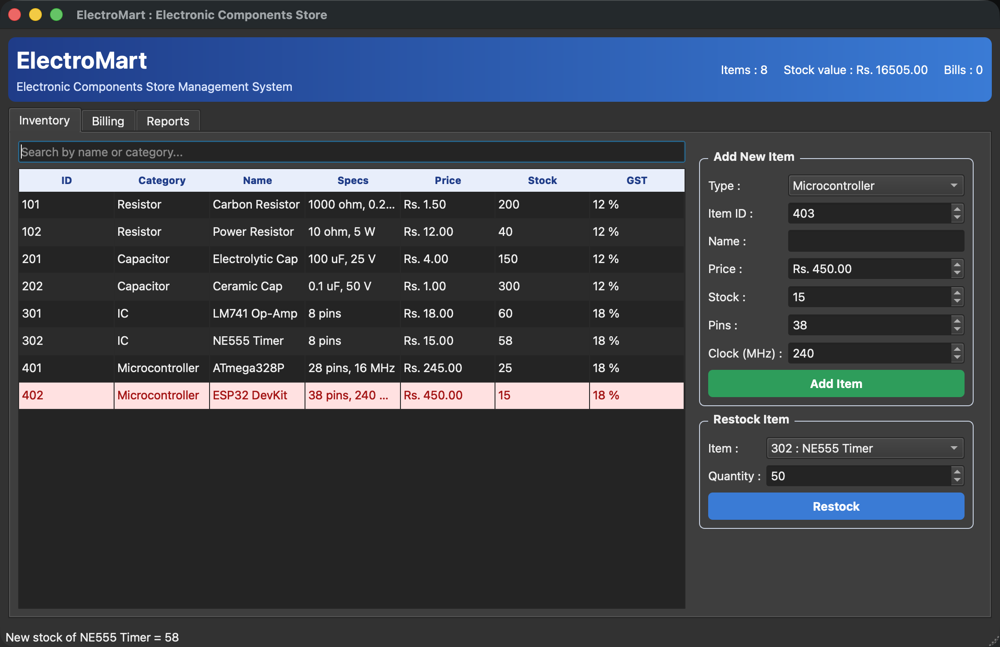
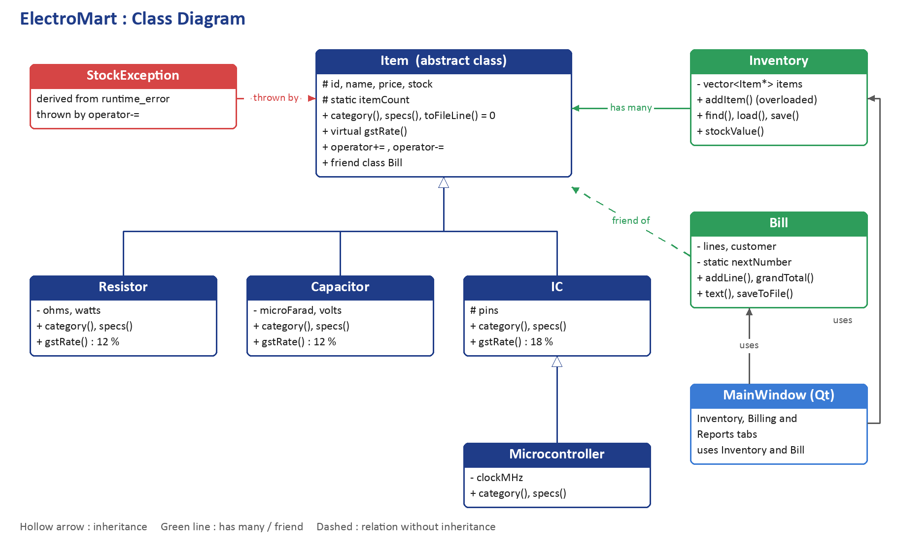
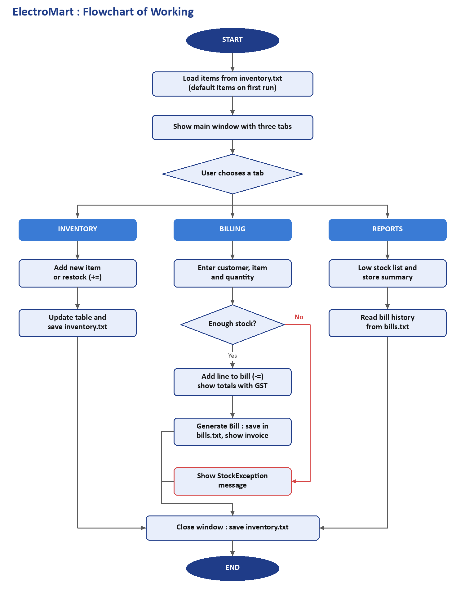
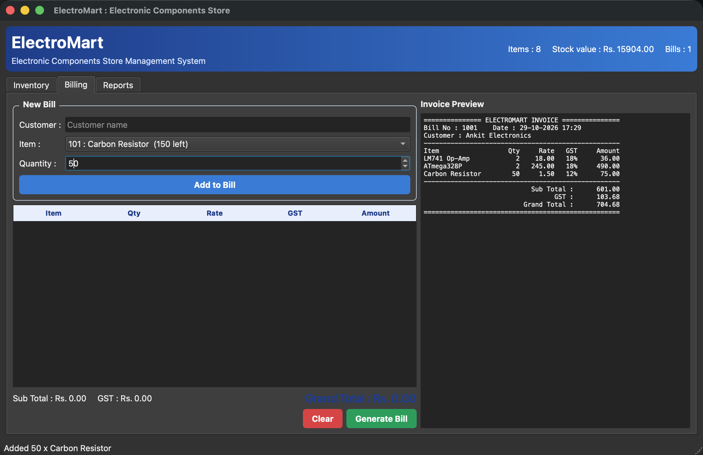
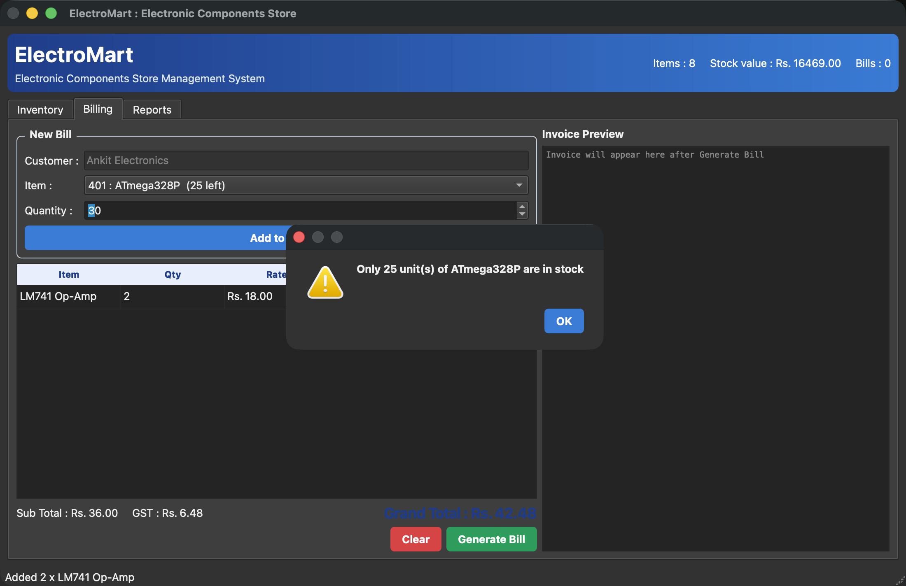
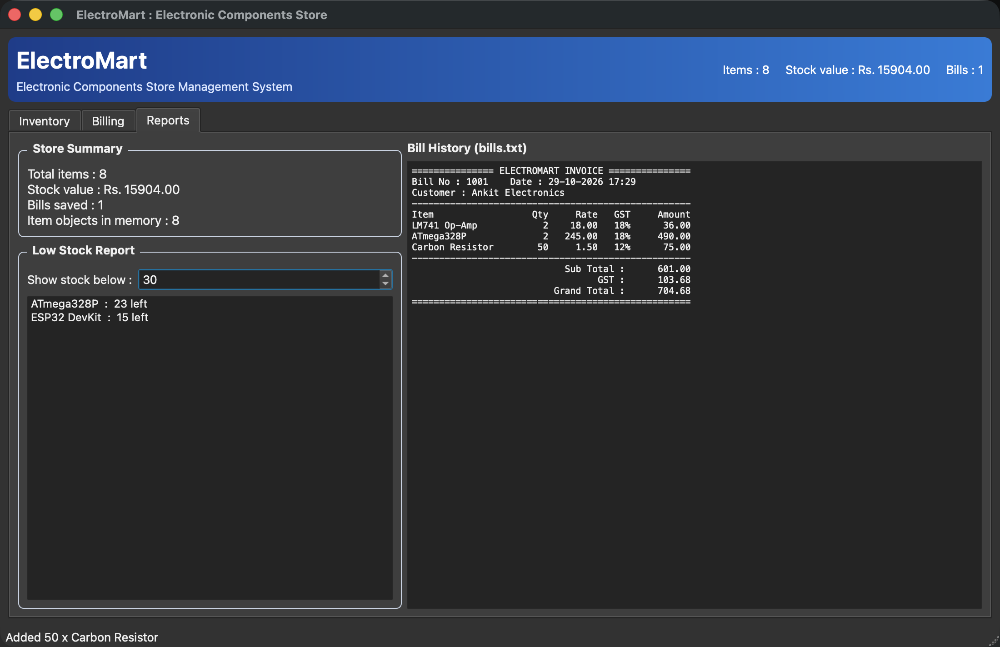

# ElectroMart : Electronic Components Store Management System

A desktop application in **C++ with a Qt GUI** to manage the stock and billing of a small
electronics shop (resistors, capacitors, ICs and microcontrollers). Made as the final project
of the Object Oriented Programming Concepts (CS203) lab at Delhi Technological University.



## Features
- Inventory table with search, low stock rows shown in red
- Add new items of four types and restock existing items
- Billing with different GST for each category (12 % for resistors and capacitors, 18 % for ICs)
- Stops selling more than the available stock (shows the error from `StockException`)
- Invoice preview, every bill saved in `bills.txt`
- Reports tab : store summary, low stock report and bill history
- Stock is saved in `inventory.txt` and loaded again next time

## Object oriented concepts used
| Concept | Where |
|---|---|
| Class and object | `Item`, `Inventory`, `Bill`, `MainWindow` |
| Abstract class | `Item` has pure virtual `category()`, `specs()`, `toFileLine()` |
| Inheritance | Hierarchical : `Item` to `Resistor`, `Capacitor`, `IC`. Multilevel : `Item` to `IC` to `Microcontroller` |
| Runtime polymorphism | `gstRate()`, `specs()` called through `Item*` |
| Operator overloading | `+=` to add stock, `-=` to reduce stock |
| Function overloading | `Inventory::addItem(Item*)` and `Inventory::addItem(string)` |
| Friend class | `Bill` is a friend of `Item` |
| Static members | `Item::itemCount`, `Bill::nextNumber` |
| Exception handling | `StockException` derived from `runtime_error` |
| File handling | `inventory.txt` and `bills.txt` using `fstream` |

## Project structure
```
src/Item.h          Item and all component classes, StockException
src/Inventory.h     Inventory class
src/Bill.h          Bill class
src/Store.cpp       code of Inventory and Bill (file handling)
src/MainWindow.h    Qt window class
src/MainWindow.cpp  GUI : Inventory, Billing and Reports tabs
src/main.cpp        starts the application
docs/               class diagram, flowchart and screenshots
```

## How to build and run
You need Qt 6 and CMake.

**macOS** (Homebrew):
```bash
brew install qtbase cmake
cmake -S . -B build -DCMAKE_PREFIX_PATH=$(brew --prefix qtbase)
cmake --build build
./build/ElectroMart
```

**Windows / Linux** : install Qt 6 (Qt Online Installer or `sudo apt install qt6-base-dev cmake`),
then open `CMakeLists.txt` in Qt Creator and press Run, or use the same two `cmake` commands.

## Design




## Screenshots
| Billing | Stock error | Reports |
|---|---|---|
|  |  |  |
